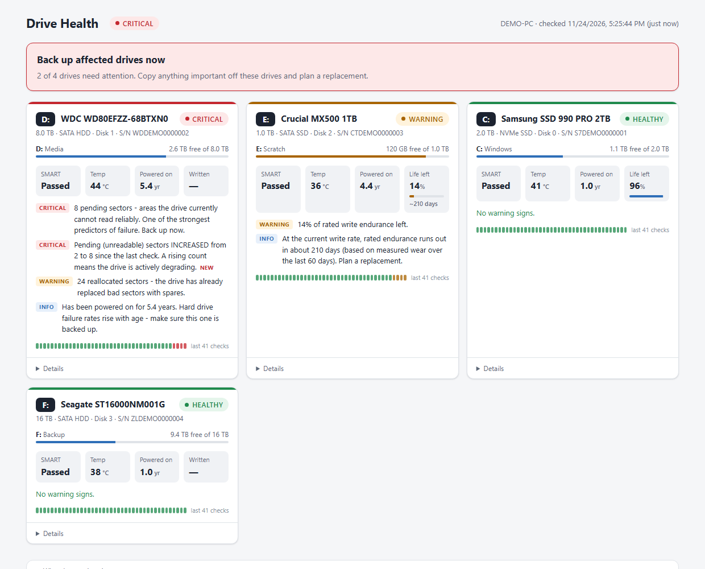

# Drive Health Monitor

Early warning for failing hard drives and SSDs on Windows.

It checks the SMART health of every drive at logon and every 6 hours, tracks the numbers over time, and alerts you **before** a drive dies, while there's still time to back up and replace it. It's just PowerShell plus an HTML dashboard, with no services, no background installs and no telemetry.



## Features

- **SMART checks for HDDs, SATA SSDs and NVMe SSDs** via [smartmontools](https://www.smartmontools.org/), with a fallback to Windows' built-in storage counters
- **Trend detection**: warns when error counters *increase* between checks. A rising count is the clearest sign a drive is degrading.
- **Windows event log scan** for bad blocks, controller errors, device resets and NTFS corruption, matched to the right disk
- **SSD endurance estimate**: days of rated write endurance left at your current write rate
- **Dashboard** with drive letters, labels, free space, temperature, power-on time, a status history strip and every SMART attribute
- **Alerts**: Windows notifications. The dashboard opens automatically for critical problems or anything new.
- **Tray icon**: green / amber / red / gray at a glance. Right-click for per-drive status and *Check now*.
- Detects a drive that **disappears** between checks

## Requirements

- Windows 10 or 11
- Windows PowerShell 5.1 (built in)
- Administrator rights once, to install. Reading SMART data requires admin, so checks run as an elevated scheduled task with no UAC prompt each time.
- [smartmontools](https://www.smartmontools.org/) (recommended). The installer offers to install it with `winget`.

## Install

1. Download or clone this repo to a **permanent** folder, for example `C:\Tools\drive-health-monitor`. The scheduled task runs the scripts from wherever they are, so don't install from your Downloads folder and then delete it.
2. Right-click `Install.ps1` → **Run with PowerShell** and approve the UAC prompt. Or run:

   ```powershell
   powershell -ExecutionPolicy Bypass -File .\Install.ps1
   ```

The installer:

- offers to install smartmontools (`winget install smartmontools.smartmontools`)
- registers the scheduled task **Drive Health Monitor** (at logon plus every 6 hours, elevated)
- adds Start menu shortcuts: *Drive Health Dashboard*, *Check Drives Now* and *Drive Health Tray Icon*
- adds the tray icon to your Startup folder
- runs the first check and opens the dashboard

Re-running `Install.ps1` is safe; it updates the existing setup. `Uninstall.ps1` removes the task, tray icon and shortcuts, and leaves your history in place.

## How alerts work

| Situation | What happens |
|---|---|
| Any **critical** problem | Notification that stays until dismissed, and the dashboard opens |
| A **new** warning (not present at the last check) | Notification, and the dashboard opens |
| An ongoing warning | Notification only |
| All healthy | Nothing (tray icon stays green) |

## What it watches

| Signal | Level |
|---|---|
| Drive's own SMART self-assessment FAILED, or an attribute below its failure threshold | Critical |
| Pending sectors (197) or offline uncorrectable sectors (198) > 0 | Critical |
| Reallocated sectors (5) > 0 (critical at 100+) | Warning |
| Reported uncorrectable (187), spin retries (10) | Warning |
| End-to-end errors (184), most recent self-test failed | Critical |
| NVMe critical warning, media errors, spare blocks below threshold | Critical |
| SSD endurance ≤ 20% (warning) / ≤ 10% (critical), under 90 days estimated (warning) | Warning / Critical |
| Temperature: HDD 50/60 °C, SATA SSD 65/75 °C, NVMe 70/80 °C | Warning / Critical |
| Any error counter **increasing** since the last check | Warning / Critical |
| Windows log: bad block, controller error, paging error, reset, NTFS corruption | Warning / Critical |
| A drive present at the last check is missing | Warning |
| Interface CRC errors (199), usually a cable problem | Info (warning if rising) |
| HDD powered on for more than 5 years | Info |

Thresholds are at the top of `DriveHealth.ps1`.

## Files

| File | Purpose |
|---|---|
| `DriveHealth.ps1` | The check. Run it directly with `-Show` to always open the dashboard, or with `-NotifyWhenHealthy`. |
| `Tray.ps1` | System tray icon. Runs as your normal user. |
| `dashboard-template.html` | Dashboard page. Data is injected into it on each check. |
| `CheckNow.cmd` | Runs the elevated task on demand and opens the dashboard |
| `Install.ps1` / `Uninstall.ps1` | Setup and removal |
| `dashboard.html`, `data\` | Generated per machine: latest dashboard, `history.json`, `status.json`, `monitor.log` |

## Notes and limits

- SMART catches many failures early, but not all. Electronics and firmware failures can happen without warning. **This complements backups; it doesn't replace them.**
- Drives behind USB enclosures, card readers and some RAID controllers often don't pass SMART data through. They appear on the dashboard with Windows' basic health status only.
- SSD endurance estimates need some measurable wear. A drive still reporting 100% life shows no estimate.

## License

[MIT](LICENSE)
